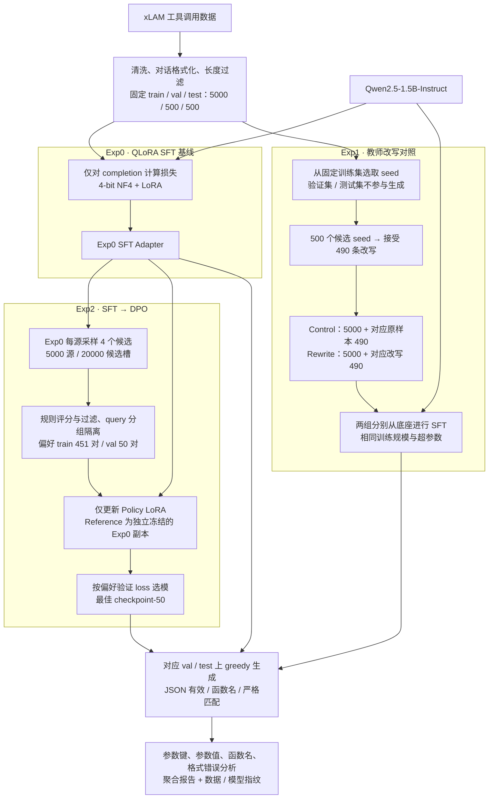

# Qwen2.5 工具调用：QLoRA 微调、数据增强与 DPO

面向结构化工具调用的模型后训练实验项目。基于 **Qwen2.5-1.5B-Instruct**，围绕“生成格式是否可靠、工具与参数是否正确”构建 **数据准备 → SFT 基线 → 教师改写对照 / DPO 偏好优化 → 评测与错误分析** 的完整实验流程。

基于 [ArunarkSingh/qwen-function-calling-lora](https://github.com/ArunarkSingh/qwen-function-calling-lora) 扩展，保留原始训练、生成、评分流程及中文阅读注释，新增 Exp1 教师改写与配对 Control、Exp2 SFT→DPO、续做校验与结果核验。具体工作与上游来源分开说明。

**核心结果：** 历史 Exp0 的500条测试中，Base→QLoRA SFT 严格匹配从 **31.0% 提升至77.4%**；Exp2 DPO 归档结果为 **Dev 79.2%、Test 78.0%**。Exp1教师改写未优于配对Control。Exp2相对Exp0的严格匹配提高0.6个百分点（3题）；这是单次实验的成绩对照，尚未进行多seed或显著性检验。

## 项目目标

输入用户请求与可用工具定义，输出JSON调用列表，每个调用包含工具名称与参数；无适用工具时约定输出空列表。实验回答三个问题：

- **SFT基线：** 小模型经QLoRA微调后，能否改善JSON输出、工具选择与参数匹配？
- **数据增强：** 在训练条数相同的条件下，教师改写是否优于重复原样本？
- **偏好优化：** 从SFT模型采样正负候选后，DPO的训练、选模与最终表现如何？

技术栈：Python、PyTorch、Transformers、PEFT / QLoRA、TRL（SFT / DPO）、Hugging Face Datasets。评价采用项目AST结构匹配，无LLM judge；不是官方BFCL榜单或真实工具执行评测。

## 项目架构



Exp1与Exp2是两条独立扩展路线：**Exp2从Exp0 SFT adapter继续训练，不接在Exp1后面。** Exp1仅向固定训练集追加教师改写数据，并为Control追加对应原样本；不重新抽样或划分验证集、测试集。各实验保留固定的500条验证题与500条测试题，题目顺序、用户问题和标准答案保持一致，复用同一套 `evaluate.py`、`error_analysis.py` 与 `scoring.py`。归档副本的敏感字段处理见下文。

## 代码目录

下面是GitHub公开代码目录。根目录六个核心脚本保留原有中文注释，Exp1 / Exp2的实现与报告分别放在各自目录。

```text
qwen-function-calling-lora/
├── README.md                         # 项目概览、架构与实验结论
├── requirements.txt                  # 原有依赖声明；环境差异见报告
├── .gitignore                        # 逐文件公开白名单
│
├── config.py                         # 模型、数据划分、LoRA与训练配置
├── prepare_data.py                   # 清洗、对话格式化、长度过滤与划分
├── train.py                          # QLoRA SFT、恢复与最佳模型保存
├── scoring.py                        # JSON解析、结构匹配与greedy生成
├── evaluate.py                       # Base / Tuned测试对照
├── error_analysis.py                 # 严格/宽松匹配与错误分类
│
├── exp1/
│   ├── __init__.py
│   ├── README.md                     # 数据增强与配对对照运行说明
│   ├── augment_data.py               # 教师请求、进度保存、两组数据导出
│   ├── augmentation_utils.py         # 提示词、格式转换与规则校验
│   └── reports/
│       ├── exp1-results.md           # 数据、训练、Test与对照边界
│       └── exp1-results-summary.json # 聚合指标与数据核验指纹
│
└── exp2/
    ├── __init__.py
    ├── README.md                     # DPO流程、环境、恢复与评测入口
    ├── utils.py                      # 路径、内容指纹与Exp0模型加载
    ├── generate_candidates.py        # 逐题采样、pilot与续做校验
    ├── generate_candidates_batch.py  # 批量采样与完整来源核验
    ├── build_preferences.py          # 正负偏好对、过滤与query分组划分
    ├── train_dpo.py                  # 双SFT模型DPO、sanity与恢复
    ├── compare_exp2.py               # val/test评测、模型选择与防覆盖
    └── reports/
        ├── experiment-report.md      # Exp0→Exp1→Exp2完整实验报告
        ├── results-summary.json      # Exp2聚合结果与来源/权重核验
        ├── local-checks.json         # 离线检查范围与结果
        └── organization-review.md    # 文件归档、公开范围与验证记录
```

数据、教师响应、偏好对、逐题预测、模型权重和checkpoint不在公开目录中。本机Exp1 / Exp2产物分别保留在 `exp1/local/`、`exp2/local/archives/`；Exp0产物和旧文件备份存放在仓库外。具体位置见 [归档记录](exp2/reports/organization-review.md)。

## 实验设计与训练配置

| 实验 | 数据构造与起点 | 关键配置 | 选模与产物 |
|---|---|---|---|
| **Exp0 · SFT** | 原始train 5000，从底座训练 | NF4 QLoRA，r16 / alpha32 / dropout0.05；3 epochs，lr2e-4，有效batch16，长度1024 | 结束939步；最佳checkpoint-600 |
| **Exp1 · Control / Rewrite** | 固定train 5000；对相同成功seed追加490条原样本 / 教师改写，验证与测试题目保持固定；分别从底座训练 | 两组均5490条；3 epochs，有效batch16，lr2e-4，长度1024；教师记录qwen3.8-flash | 均结束1032步；最佳Control500 / Rewrite700 |
| **Exp2 · DPO** | 从Exp0 adapter继续；采样正确与合法结构但评分错误的同源候选形成偏好对，无gold fallback | 451 / 50对；3 epochs，microbatch2 × 累积8，lr5e-6，beta0.1，长度2048 | 结束87步；偏好验证loss选择checkpoint-50 |

Exp2的50对偏好验证集来自原train的独立query group，用于训练选模；原500条val用于生成质量开发评测，两者用途不同。4×4正式尝试出现OOM，成功运行采用2×8；最终adapter的392个张量已与最佳checkpoint转换精度后逐元素核对一致。

## 实验结果

以下Test均使用固定的500条测试题、greedy生成及同一套评分代码。Base与Exp0取已有基线实验记录；Exp1只扩充训练集，Exp2从Exp0继续DPO。表格对照各次实验成绩，Exp1与Exp2不是依次串接的训练阶段。

| 实验 | JSON有效率 | 函数名准确率 | 严格匹配EM | 正确 / 总数 |
|---|---:|---:|---:|---:|
| Base（Exp0记录） | 76.6% | 44.6% | 31.0% | 155 / 500 |
| **Exp0 SFT** | **99.2%** | **98.8%** | **77.4%** | **387 / 500** |
| Exp1 Control | 99.4% | 98.8% | 77.2% | 386 / 500 |
| Exp1 Rewrite | 99.6% | 99.2% | 76.8% | 384 / 500 |
| **Exp2 DPO** | **99.2%** | **98.8%** | **78.0%** | **390 / 500** |

Exp2在原500条Dev（val）上的结果为 **JSON 99.8%、函数名99.4%、严格匹配79.2%（396/500）**。其他实验未找到可用的完整Dev生成质量报告，不以训练eval_loss代替，也不补造指标。

### 实验结论

1. **SFT建立了有效基线。** 历史Exp0中，严格匹配31.0%→77.4%（+46.4个百分点），JSON有效率76.6%→99.2%，改善体现在结构输出、工具选择与参数匹配。
2. **本轮教师改写没有整体收益。** Rewrite相对相同规模的Control，JSON高0.2个百分点、函数名高0.4个百分点，但严格匹配低0.4个百分点（少对2题），不能据此宣称增强有效。
3. **DPO在本次测试中取得小幅提高。** 固定500题测试划分上，Exp0为77.4%（387/500），Exp2为78.0%（390/500），严格匹配提高0.6个百分点，即多答对3题。该差值来自已有实验成绩，不要求重新运行Exp0才能报告；尚未进行多seed或显著性检验，不据此宣称稳定或显著提升，也不将正确数净增3题解释为逐题修复了3题。
4. **剩余错误集中在参数。** Exp2的110个Test失败中，参数值63、参数键41，占104/110（约94.5%）。后续可重点检查参数约束、默认值与标签语义，这些是待验证方向。

### Test错误分布

| 错误类别 | Exp0 | Exp1 Control | Exp1 Rewrite | Exp2 |
|---|---:|---:|---:|---:|
| 参数值错误 | 61 | 62 | 58 | 63 |
| 参数键错误 | 46 | 45 | 51 | 41 |
| 函数名错误 | 2 | 3 | 1 | 2 |
| 无效JSON | 4 | 3 | 2 | 4 |
| 调用数量错误 | 0 | 0 | 1 | 0 |
| 其他 | 0 | 1 | 3 | 0 |
| **总失败** | **113** | **114** | **116** | **110** |

分类沿用 `diagnose` 启发式；类别总量差异不等于逐题修复数量。数据构造、指纹、选模和局限见 [完整实验报告](exp2/reports/experiment-report.md)；Exp1细节见 [配对对照报告](exp1/reports/exp1-results.md)。

## 运行与复现

从仓库根目录执行。根六脚本共用 `config.py`，Exp1 / Exp2使用 `python -m ...` 包入口。需要具备数据访问条件、兼容依赖与GPU环境，公开仓库不附带数据或权重。

新Exp0运行将输出指向全新、仓库外目录，避免覆盖成果：

```powershell
$env:OUTPUT_ROOT = 'E:/qwen-fc-runs/exp0-new'
python prepare_data.py
python train.py
python evaluate.py
python error_analysis.py
```

Exp1先构建共享成功seed的Rewrite / Control，再分别设置 `OUTPUT_ROOT` 训练；Exp2依次执行候选采样、偏好构造、sanity与恢复检查、正式DPO、val与test评测。完整命令见 [Exp1运行说明](exp1/README.md) 与 [Exp2运行说明](exp2/README.md)。不要对已构建的Exp1数据再次执行 `prepare_data.py`。

Exp2归档环境包括torch2.6.0+cu126、transformers5.12.1、peft0.19.1、trl1.7.1、datasets5.0.1；根requirements中的datasets4.0.0与之不同，不能将其当精确冻结环境。底座revision未锁定、批量与逐题采样轨迹不同，不承诺逐位复现。

## 结果可信范围

- **已核验：** Exp2落盘500条val / test预测重新评分、gold与本地原始数据逐条一致；5000×4候选来源、偏好query组隔离、内容指纹、final与best权重一致性；12组离线检查通过。见 [聚合结果](exp2/reports/results-summary.json) 与 [本地检查](exp2/reports/local-checks.json)。整理与文档更新未重新训练或GPU推理。
- **数据划分与归档说明：** Exp1的教师生成与数据追加仅作用于训练集，验证/测试没有重新划分或增删题目。本次逐条核对确认各组验证/测试的用户问题、顺序及标准答案一致，评分与错误分析源码也一致。保存的Exp1数据与原始副本在val第129条、test第127条的系统提示中仍有工具定义敏感字段的替换差异；这是归档数据的脱敏差异，不能等同于更换了验证/测试题目，也不能把两份文件说成逐字节相同。
- **评分范围：** `scoring.score`解析JSON后比较调用集合，忽略调用顺序并折叠重复调用；JSON有效不等于完整Schema合法或执行成功。没有真实工具执行、LLM judge或官方BFCL成绩。
- **发布范围：** 公开源码、说明和聚合结论，原始/脱敏数据及衍生样例、凭证、模型和备份保留本地。历史Git提交未改写，当前目录清理不等于清除旧历史。

## 来源与贡献

| 范围 | 来源 / 本仓库工作 |
|---|---|
| QLoRA SFT、基础生成与AST评分 | 复用上游实现，保留署名与源码阅读注释 |
| Exp1 | 教师改写、规则过滤、进度保存、按成功seed构建配对Control、训练结果对照 |
| Exp2 | 候选采样、偏好构造与分组隔离、双SFT模型DPO、恢复防护、Dev / Test与模型核验 |
| 实验记录 | 数据/权重指纹、错误分析、失败记录、聚合报告与验证边界 |

数据来自 [Salesforce / xLAM function-calling-60k](https://huggingface.co/datasets/Salesforce/xlam-function-calling-60k)，相关工作为 [APIGen](https://arxiv.org/abs/2406.18518)。使用者须确认来源访问和使用条件；脱敏不构成再分发授权。本仓库不另行授予数据或上游代码许可，不将复用流程宣称原创算法。
